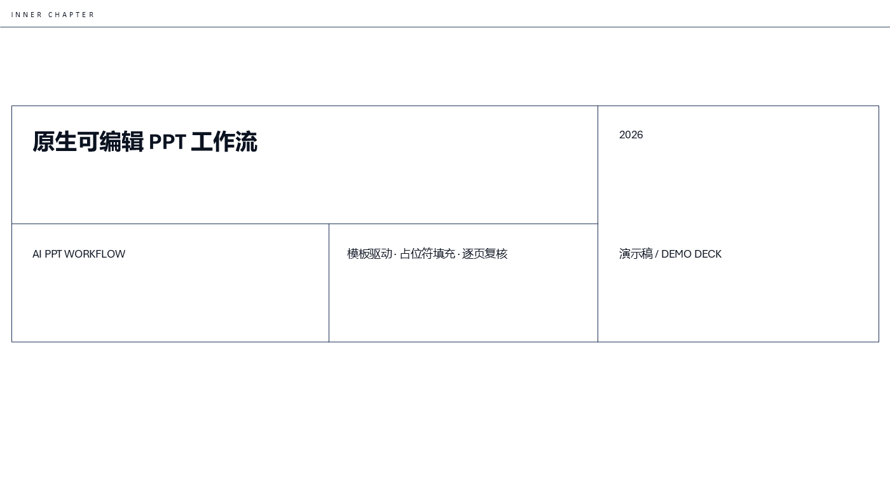

# AI PPT Workflow

模板驱动、原生可编辑、可验证的 PowerPoint 工作流 —— **仓库自带三套开箱即用的 PPT 模板**。

它不是“从零画一套卡片”的 PPT 生成器，而是：

```text
选模板 → 研究内容 → 按版式填字 → 替换图片/图标/图表 → PowerPoint 重开验证 → 逐页 PNG 复核
```

## 快速开始

```bash
git clone https://github.com/xieyinch/ai-ppt-workflow.git && cd ai-ppt-workflow
python -m pip install -r requirements.txt

python scripts/new_deck.py 我的汇报 --template inner-chapter-navy   # 从预制模板出稿
python src/run_workflow.py --config decks/我的汇报/deck.config.json  # 构建 + QA + 逐页 PNG
```

`new_deck.py` 会扫出模板里所有可编辑文字槽，生成 `content.json`（`模板原文 → 你的文字`）。
改完这个 JSON 再跑第二条命令即可，版式、配色、字体全部继承模板。

## 预制模板包（MIT，下载即用）

| slug | 风格 | 适用 |
|---|---|---|
| `inner-chapter` | 黑白极简 + 蓝橙强调，59 套版式 | 咨询汇报、评审、复盘 |
| `inner-chapter-navy` | 白底深蓝，微软雅黑 | 技术方案、课程汇报、企业对外 |
| `inner-chapter-ink` | 暖纸墨金，思源黑体 CN | 材料/建筑/人文类学术汇报 |

每套目录里有：`template.pptx`（空母版，59 套版式）、`starter.pptx`（9 页示例稿，改字即用）、
`previews/`（逐页 PNG）、`LICENSE`。清单见 `templates/manifest.json`，
用法与授权见 [`templates/README.md`](templates/README.md) 和 [`templates/ATTRIBUTION.md`](templates/ATTRIBUTION.md)。

三套模板共用同一母版，只换主题色板与中文字体；换风格不必重排版式。



## 特点

- **模板优先**：自带模板 + 真实母版版式，不是代码画卡片
- Windows PowerPoint COM 写入，保留母版与可编辑性
- 重复占位符可用数组逐个填充（同款卡片一次填多栏）
- 支持图片、图标和原生图表数据替换
- 自动重新打开生成的 PPTX，自动导出每页 PNG，生成 contact sheet
- **讲稿写进 PPT 备注**：`notes.md` 按 `## Slide N` 分段，构建后自动注入备注页并回读校验
- **文字溢出预检**：按真实字体度量逐框估算，输出 `*-overflow.json`，避免交付前才发现文字压边
- **版式重复预检**：禁止连续 3 页同一版式、禁止单一版式占比 >40%，输出 `*-diversity.json`（就是“5/6/7 页一模一样”那个问题）
- 结构 QA：页数、占位符、关键词、讲稿、来源和媒体
- 支持自带 `.pptx` / `.potx` 模板，或用 `--blank` 从 59 套版式里自选
- 每次运行记录实际后端和产物可编辑性，不把 HTML 或图片型 PPTX 冒充成原生可编辑

## 环境

- Windows 10+ 与 Microsoft PowerPoint（生成 + PNG 导出靠 COM）
- Python 3.10+，依赖：`pip install -r requirements.txt`

## 内容映射

普通文字替换：

```json
{"map": {"模板原文": "新的内容"}}
```

同一占位符重复出现在多个卡片中时使用数组：

```json
{"map": {"这里是小标题": ["第一栏", "第二栏", "第三栏"]}}
```

图片或图标替换：

```json
{"images": [{"kind": "picture", "occurrence": 1, "file": "assets/example.png"}]}
```

原生图表数据替换：

```json
{"charts": [{"occurrence": 1, "categories": ["A", "B"], "series": {"系列1": [10, 20]}}]}
```

完整流程、路由与限制见 [`WORKFLOW.md`](WORKFLOW.md)；作为 Hermes / Claude 技能使用见 [`SKILL.md`](SKILL.md)。

## 命令一览

| 命令 | 作用 |
|---|---|
| `python scripts/new_deck.py --list` | 列出预制模板 |
| `python scripts/new_deck.py <名字> --template <slug>` | 脚手架出稿（含 content.json） |
| `python scripts/new_deck.py <名字> --template inner-chapter --blank` | 从空母版起步，自选 59 套版式 |
| `python src/run_workflow.py --config <cfg>` | 构建 + QA + 逐页 PNG + contact sheet |
| `python src/qa.py <cfg>` | 只跑结构校验 |
| `python src/write_notes.py <deck.pptx> <notes.md>` | 把逐页讲稿写入 PPT 备注（`--check` 只校验） |
| `python src/check_overflow.py <deck.pptx> [--limit 1.0] [--json r.json]` | 文字溢出预检（`--strict-overflow` 可让整轮构建失败） |
| `python src/check_layout_diversity.py <deck.pptx> [--max-run 2] [--max-share 0.4]` | 版式重复预检（`--strict-diversity` 可让整轮构建失败） |
| `powershell -File scripts/render_previews.ps1 -Pptx <deck.pptx> -OutDir render` | 只导 PNG，用于逐页复核 |

## 公开发布范围

本仓库只发布工作流代码、文档、示例、自制示例稿与三套 MIT 授权模板（含上游版权声明），
不包含任何用户私有模板、网盘文件、个人资料、生成成品、聊天记录、浏览器数据或运行缓存。

## 许可证

- 代码与文档：MIT License
- `templates/` 下的模板：见 `templates/ATTRIBUTION.md`（上游 MIT，派生版保留原声明）
